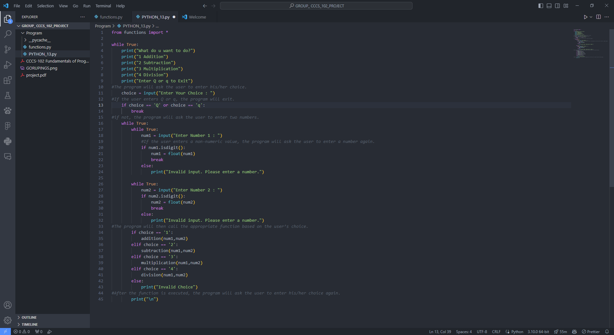
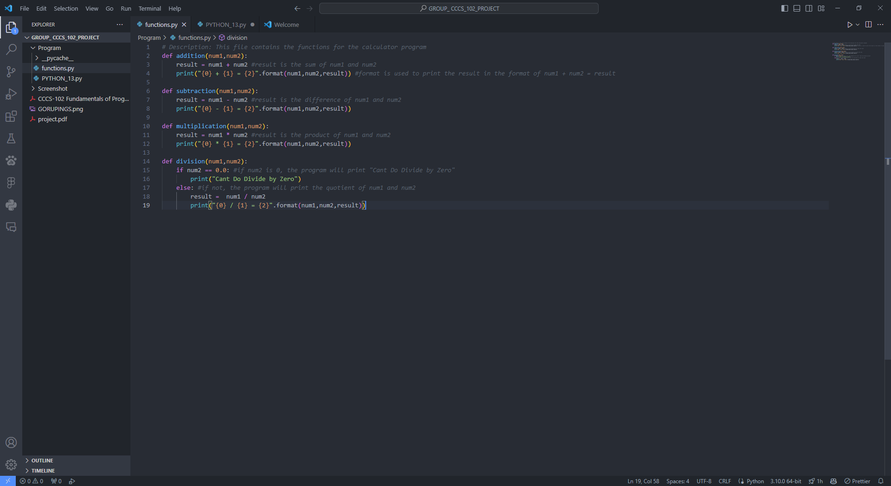
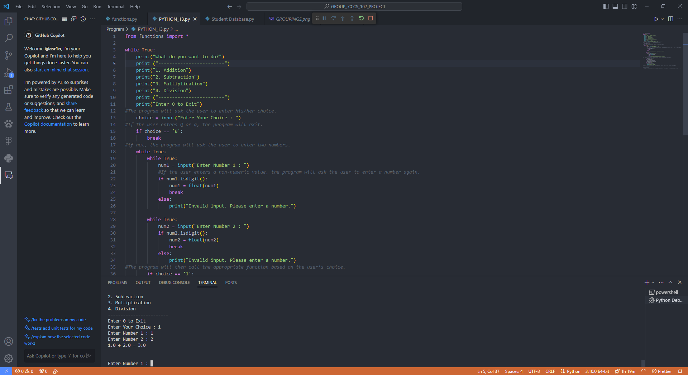

# Jejemon Text Corrector (with Calculator)

Related: the individual exercises from the same course are in the `cccs102-projects` repository.


A console calculator with a built-in "jejemon" typing corrector. This was our final project and final exam for **CCCS 102: Fundamentals of Programming**, done as a group of three and submitted in December 2023.

**Group members:** Lawrence Atienza, Ivy M. Doroin, Mark Joseph C. Orias (BSCS 1A, Camarines Sur Polytechnic Colleges)

## Contents

- [Overview](#overview)
- [Features](#features)
- [How to run](#how-to-run)
- [Project development](#project-development)
- [Timeline](#timeline)
- [Results](#results)
- [What I would improve](#what-i-would-improve)
- [Repository layout](#repository-layout)

## Overview

The course brief asked for a program that covers four things: algorithm design with basic input and output, operators and control structures, string manipulation, and file handling with exception handling. We decided to build one small program that touches all four instead of four separate scripts. The same topics were practised on their own in `python-fundamentals` (in the `cccs102-projects` repository), for example string manipulation and file handling.

The result is a menu-driven calculator. For the string and file parts, we added a tool that fixes "jejemon" text, which is the number-for-letter style of typing that is common online in the Philippines (for example `h3ll0` instead of `hello`).

## Features

- Addition, subtraction, multiplication and division
- Division by zero is caught and reported instead of crashing the program
- Every calculation is stored in a history list
- The history can be saved to a text file and loaded back later
- Jejemon typings corrector: reads a text file, replaces the digits `0 1 3 4 5 7` with `o i e a s t`, and writes the result to `<name>_corrected.txt`
- Input validation: typing letters where a number is expected shows an error message

## How to run

You only need Python 3. There are no extra packages.

```bash
cd submission/source
python3 "A Simple Calculator & Text Typing Corrector.py"
```

A sample file for the corrector is included as `FOR_TYPINGS_CORRECTOR.txt`. Choose option `7` in the menu and enter that file name.

## Project development

We built the program in stages, and the early versions are in [Program/](Program/) and the final one is in [submission/source/](submission/source/).

**1. Basic menu calculator.** We started with a `while True` loop that prints a menu, reads the choice, asks for two numbers and calls a function. The four operations live in `functions.py` and the menu is in `PYTHON_13.py`. This first version only exits when you type `Q` or `q`. `Calc.py` is an even earlier take on the same menu: it reads the numbers with `float(input(...))` and has no checks, so typing a letter crashes it.



*Early version: the menu loop and the number checks. Entering `Q` or `q` exits.*



*`functions.py` with `addition`, `subtraction`, `multiplication` and `division`. Division checks for zero first.*

**2. Cleaner menu and input checks.** We changed the exit to option `0` so all choices are numbers, and added loops that keep asking until the user types a valid number. The check used `isdigit()`, which works for whole numbers but rejects decimals and negatives like `2.5` or `-3`.



*Second version running in the VS Code terminal: `1.0 + 2.0 = 3.0`, then it asks for the next numbers.*

**3. Final version with a `Calculator` class.** We moved everything into one file. A `Calculator` class holds the history list and has one method per operation plus `save_history` and `load_history`. For input, we replaced `isdigit()` with `float()` inside `try`/`except ValueError`, so decimals and negative numbers now work. The jejemon corrector became menu option `7`.

The submitted source is in [submission/source/](submission/source/) and the written documentation is [submission/PROJECT.pdf](submission/PROJECT.pdf). The documentation follows the format in the brief ([Documentation/project.pdf](Documentation/project.pdf)): introduction, code snippets for each task, explanations, output screenshots, challenges and conclusion.

## Timeline

The project took about two weeks from the brief to the submission. The dates below are the last-modified times of the files in this repository, so they show when each part was last saved, not exactly when it was started.

| Date | What happened |
|---|---|
| 30 Nov 2023 | Received the project brief (`Documentation/project.pdf`) |
| 3 Dec 2023 | First calculator screenshots (`CalcDev1`, `CalcDev1.1`, `CalcDev1.2`) |
| 5 Dec 2023 | `PYTHON_13.py`, `functions.py` and `Calc.py` last edited |
| 13 Dec 2023 | Flowchart (`CALCULATOR.drawio`), the final program and its sample file, and the finished `PROJECT.pdf` |

## Results

The final program works for all of the features above. This is a real run of the submitted file (menu text trimmed):

```text
Enter your choice: 1
Enter first number: 10
Enter second number: 5
Result: 15.0

Enter your choice: 4
Enter first number: 7
Enter second number: 0
Error: Division by zero is not allowed.

Enter your choice: 5
Enter filename to save history: history.txt
History saved successfully.

Enter your choice: 6
Enter filename to load history: history.txt
History loaded successfully.
Added 10.0 and 5.0 = 15.0
Error: Division by zero is not allowed.

Enter your choice: 7
Enter the file path: jeje.txt
File corrected and saved as: jeje_corrected.txt

Enter your choice: 0
Exiting the calculator.
```

In the run above, `jeje.txt` is a copy of the included `FOR_TYPINGS_CORRECTOR.txt`. The corrector turns its first line,

```text
H3ll0 th3r3! I w4s w0nd3r1ng 1f y0u'd l1k3 t0 m33t up s0m3t1m3 s00n. W3 c4n h4ng 0ut 4nd h4v3 s0m3 fun. Wh4t d0 y0u th1nk?
```

into

```text
Hello there! I was wondering if you'd like to meet up sometime soon. We can hang out and have some fun. What do you think?
```

## What I would improve

Going back over the code, these are the things I would fix with more time:

- **Invalid menu choice exits the program.** The final `else` branch has a `break`, so a typo like `9` closes the calculator. It should print the message and show the menu again.
- **The four operations repeat the same input code.** The `try`/`except` block is copied four times in `menu()`. One helper function that asks for two numbers would remove that.
- **Division by zero returns `None`.** `divide` prints its own error and returns the result of `print`, which is why `menu()` has to check `result is not None`. Raising an exception would be cleaner.
- **The corrector only handles digits.** It cannot fix jejemon text that uses random capital letters (`hElLo`) or symbols like `$`.

## Repository layout

| Path | Contents |
|---|---|
| [submission/source/](submission/source/) | Final submitted program and the sample text file for the corrector |
| [submission/PROJECT.pdf](submission/PROJECT.pdf) | Written documentation (16 pages) |
| [Program/](Program/) | Scripts from the development stages (`Calc.py`, `PYTHON_13.py`, `functions.py`) |
| [Documentation/](Documentation/) | The project brief (`project.pdf`), and development screenshots |
| `CALCULATOR.drawio` | Flowchart source, open it with [diagrams.net](https://app.diagrams.net/) |

`Calc.py` and `PYTHON_13.py` import from `functions.py`, so run them from inside the `Program` folder.

Related: the individual exercises from the same course (`python-fundamentals`) are in the `cccs102-projects` repository.
